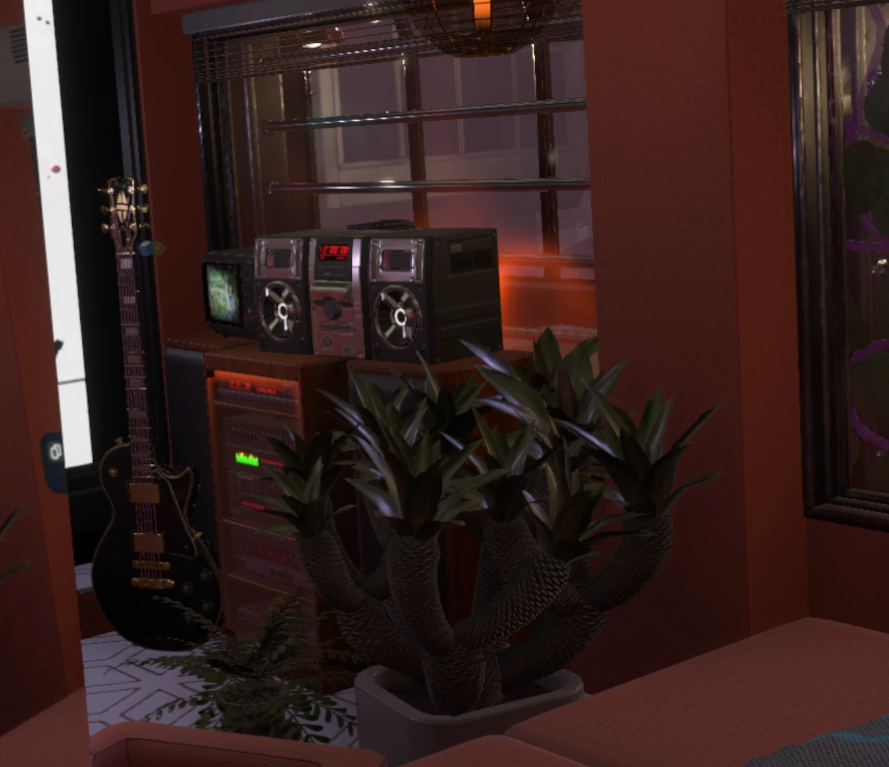
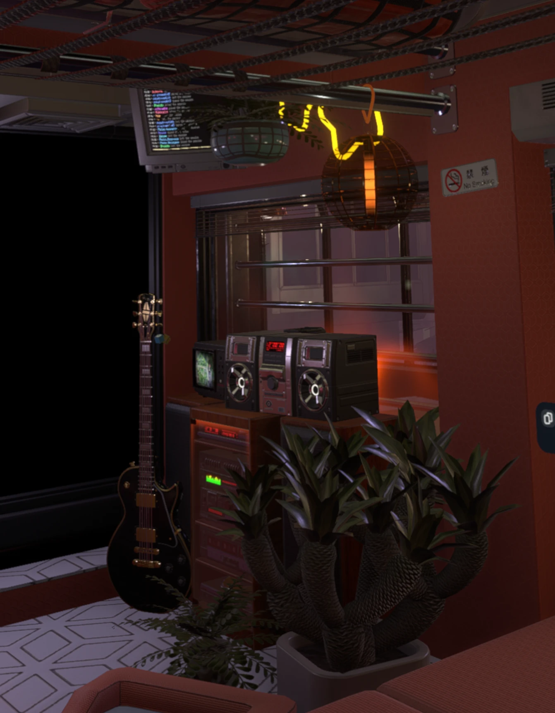

# Resonite FSR 3.1 (alpha)

> ## 🤖 AI-generated software
>
> I made this mod with an AI coding assistant (Anthropic's Claude). The code, shader changes and patches were
> written by AI. I directed it, tested every build in-game (desktop and VR) and reported what broke until it worked.
> I know the Resonite community has strong and mixed feelings about AI, so I want that to be clear up front.
> Judge it however you like. The source is all here.

This mod replaces Resonite's **TAA** anti-aliasing option with **AMD FidelityFX Super Resolution 3.1** temporal
anti-aliasing, on desktop **and in VR**. Resonite normally turns TAA off in VR, leaving only SMAA and FXAA there. This
gives you proper temporal anti-aliasing instead: much cleaner edges, far less shimmer on thin details, and a more
stable image.

| Before | After (FSR 3.1) |
|---|---|
|  |  |

*Captured in VR. Look at the guitar strings, the window blinds and the edges of the plant leaves.*
<!-- TODO: note which anti-aliasing / settings the "Before" image used -->

> ## ⚠️ By default this makes the game look better, not run faster
>
> By default FSR 3.1 runs as **native anti-aliasing** (render resolution = output resolution). That costs GPU time
> and doesn't speed anything up.
>
> On my setup (RX 7900 XTX, Bigscreen Beyond 2e at 100% SteamVR resolution = 3562 × 3562 per eye, 75 Hz) it adds
> about **5 ms of GPU frame time**. That's a big chunk of a 13.3 ms frame budget. Lower resolutions cost
> proportionally less. If you're already struggling to hold frame rate, this will make it worse.
>
> For a performance gain in VR, use the experimental **FSR 3.1 upscaling** mode (see below): it renders at a lower
> resolution and FSR 3.1 rebuilds the full image. In a heavy world on my setup, upscaling from 67% took GPU time from
> about **21 ms to 12 ms** per frame, roughly doubling the frame rate there (about 37 → 72 fps at 75 Hz). It also runs
> better than stacking native AA with the vrperfkit add-on's FSR 1 upscaling, and looks better.

> ## 🧪 Alpha
>
> It works and I use it every day, but expect rough edges (see **Known issues**). Settings and behaviour may change
> between versions. If something breaks, please open an issue and include your `Renderer\BepInEx\LogOutput.log`.
>
> **What I've tested:** desktop, and VR on a Bigscreen Beyond 2e (RX 7900 XTX) **with the vrperfkit add-on's `dxgi.dll`
> installed**: native AA, FSR 3.1 upscaling, native AA + FSR 1, and the experimental eye-tracked foveated rendering.
> I haven't tested VR without the add-on installed, so if you try that, I'd like to hear how it goes.

<!-- TODO: replace "open an issue" above with the repository's issues link, e.g. https://github.com/poiuytrewq4645/ResoniteFSR3/issues -->

## Download

- **Mod manager (recommended):** search for *ResoniteFSR3* in Gale / r2modman (Thunderstore).
  <!-- TODO: add the Thunderstore page link after uploading -->
- **Manual / vrperfkit add-on:** see the GitHub **Releases** page.

## How to use

1. Install with a Thunderstore mod manager (Gale / r2modman). Dependencies install automatically.
2. Launch Resonite.
3. **Settings → Graphics → Anti-aliasing → TAA.** That's it: TAA is now FSR 3.1.

Every option is in **Settings → Mods → Resonite FSR 3.1** in the dashboard and applies **live**, without restarting.

## Settings

| Section | Setting | What it does |
|---|---|---|
| General | Enabled | Turn FSR 3.1 on/off (off = Resonite's own TAA, which stays disabled in VR). |
| General | EnableInVR | Allow TAA/FSR in VR. |
| Quality | Sharpening / Sharpness | FSR's RCAS sharpening. Lower it if thin, bright UI edges get halos. |
| Quality | VelocityFactor | Lower = more stable, more ghosting. |
| Quality | Upscaling | **Experimental.** VR only. Renders each eye at a lower resolution and upscales it with FSR 3.1 (UltraQuality 83% … Performance 50% per axis, or Custom down to 33%). Changes live, with a brief hitch while the eye textures are reallocated. Needs the vrperfkit add-on's `dxgi.dll`, with the add-on's own FSR 1 upscaling **off** (the default). |
| Motion Vectors | TreatNoMotionAsCamera | Fixes smearing on objects whose creator set *MotionVectorMode = NoMotion*. On by default. |
| Reactive Mask | Enabled / Scale / Threshold / BinaryValue | Reduces ghosting on transparent objects (glass, particles). |
| vrperfkit FSR 1 (legacy, normally OFF) | Enabled / RenderScale / Sharpness | The add-on's older FSR 1 upscaling. **Off is normal**: FSR 3.1 upscaling still uses the add-on with this off. Only turn it on to use FSR 1 *instead of* FSR 3.1 upscaling, never both. Applies on next launch. |
| Foveated Rendering | Mode, Gaze, QuadView… | **Very experimental** eye-tracked foveated rendering, see below. Off by default. |
| Calibration | DebugView, DisableHistory, … | Diagnostics. DebugView shows FSR's inputs (motion vectors, depth, masks). |

## VR performance: FSR 3.1 upscaling (experimental)

Set **Quality → Upscaling** to anything below NativeAA (in VR) to render at a lower resolution and let FSR 3.1
upscale it back. This needs the vrperfkit add-on's `dxgi.dll` (below) installed, because that's what hands FSR's
full-resolution output to SteamVR. Keep the add-on's own FSR 1 upscaling **off** (the default), or the two stack.

**Quality** (67% per axis) is a good starting point. It's what I use and what the numbers above were measured with.

## Very experimental: eye-tracked foveated rendering (quad views)

If your headset has eye tracking, **Foveated Rendering → Mode = QuadViews** renders the whole view at a low
resolution (`QuadViewOuterScale`) and adds a small full-resolution inset per eye that follows your gaze, with FSR 3.1
anti-aliasing inside it.

- **Gaze source:** `SteamVR` (default) reads gaze straight from SteamVR, which works with any eye tracker that has a
  SteamVR driver (I use Bigscreen's own eye tracking on the Beyond 2e). Until SteamVR reports gaze, it falls back to
  the eye tracking Resonite itself receives (e.g. Babble). If the inset doesn't move, check that your eye-tracking
  driver is enabled in SteamVR's *Manage Add-ons*.
- **It works, but it isn't faster yet.** Each inset is an extra camera, so the scene is drawn twice more per frame.
  In my heavy-world test that extra CPU work cost more than the pixels it saved: plain FSR 3.1 upscaling at 67% ran
  better (12.4 ms GPU / ~72 fps) than quad views at 51% outer (14.1 ms GPU / ~56 fps). It may pay off in worlds
  that are GPU-bound rather than CPU-bound, or at higher SteamVR resolutions.
- `QuadViewInsetSize`, `QuadViewFeather` and `QuadViewOuterUpscaler` (Bilinear or FSR) shape the inset and the
  periphery; `QuadViewShowBorder` draws a ring at the inset's edge. `RunBenchmark` compares native, upscaling and quad
  views automatically and writes a CSV to `Renderer\BepInEx`.

## vrperfkit add-on (needed for VR upscaling)

This is a patched build of [VRPerfKit_RSF](https://github.com/RavenSystem/VRPerfKit_RSF) that actually works with
Resonite's renderer. The stock versions hook the wrong OpenVR interface and do nothing. The mod uses it to hand its
full-resolution FSR 3.1 output to SteamVR, so **FSR 3.1 upscaling and foveated rendering need it**. Native AA works
without it.

It can also do its own FSR 1 upscaling at submit (vrperfkit's original feature). **That setting being off is normal**
and doesn't disable the add-on: FSR 3.1 upscaling still runs through it. FSR 3.1 upscaling looks and runs better,
and the two shouldn't be stacked.

Mod managers can't install it because it's a `dxgi.dll` proxy, so install it manually: copy `dxgi.dll` and
`vrperfkit_RSF.yml` into `Resonite\Renderer\` (next to `Renderite.Renderer.exe`). Delete both files to uninstall. Its
render scale can then be changed from the in-game settings page (takes effect on next launch).

## Known issues

- **Resonite UI ghosts or fizzes when you move or drag menus.** Resonite's UI has no motion vectors and is drawn
  before the reactive-mask capture, so FSR reuses history along the wrong motion. Thin, high-contrast UI details (like
  the ring around profile pictures, or small text) can shimmer.
- **Objects that move with your view** (rare HUD-style content) may smear while *TreatNoMotionAsCamera* is on.
- **Resolution changes** (e.g. loading screens) briefly rebuild FSR's buffers, which can cause a hitch.
- **FSR 3.1 upscaling is experimental.** Textures look a little softer than they should at lower render scales
  (FSR's texture mip-bias adjustment isn't applied yet), and changing the setting causes a short hitch.
- **SteamVR screenshots don't show the final image** when upscaling or foveated rendering is on. They appear to capture
  Unity's own eye textures, not the upscaled ones the add-on swaps in at submit. What you see in the headset is
  correct.
- **No sub-pixel jitter in VR.** Unity 2019 refuses custom eye projections in single-pass stereo, so in VR FSR works
  as a temporal smoother (head motion supplies most of the sub-pixel variation). Desktop and the foveated inset get
  full jitter.
- Only single-pass stereo VR (Resonite's default) and DirectX 11 are supported.

## How it works (for the curious)

- FSR3Unity (a built-in render pipeline port of AMD FSR 3.1) back-ported to Resonite's Unity 2019.4 renderer: constant
  buffers converted to structured buffers, shader keywords baked into fixed variants, and explicit UAV bindings where
  Unity 2019 doesn't auto-bind temporary render targets.
- Harmony patches replace Post-Processing Stack v2's TAA resolve and jitter with FSR's, and stop Resonite from forcing
  TAA off in VR.
- Resonite renders VR as single-pass double-wide, where PPv2 treats both eyes as one image. The mod splits each eye out
  and gives each its own FSR context and history.
- A small engine-side companion plugin puts the renderer's settings in the dashboard (via BepisModSettings) and
  mirrors changes to the renderer, which reloads them live.
- VR upscaling shrinks Unity's eye textures, captures depth and motion during post-processing, then runs FSR 3.1 on
  the finished image at the end of the frame into a full-resolution texture per eye. The patched vrperfkit `dxgi.dll`
  swaps those textures in when the eyes are submitted to SteamVR. Unity's final eye texture is stored top-down while
  its intermediate render textures are bottom-up, so the final image is flipped to match before FSR runs.
- Quad views adds one ordinary camera per eye, placed at the eye and rotated to look along the gaze, rendered by Unity
  just before the main view with the same post-processing. Its image is blended over the upscaled eye through a
  perspective-correct quad. (Rendering the insets manually, or cropping the eye's off-centre projection, both broke
  Unity's motion vectors and with them FSR's history.)

## Building from source

Requirements: Windows, the Unity **2019.4** editor (any 2019.4 patch release; Resonite's renderer is 2019.4.19f1),
.NET SDK 8 (renderer plugin) and **.NET SDK 10** (dashboard settings plugin), and a Resonite install with the
dependencies above (the projects reference Resonite's own assemblies).

1. Clone [ndepoel/FSR3Unity](https://github.com/ndepoel/FSR3Unity) into `upstream-FSR3Unity/`.
2. `tools/prepare-shaders.ps1` copies the FSR 3.1 shaders into `ShaderProject/` and applies the Unity 2019 adaptations.
3. Build the shader bundle headless:
   `Unity.exe -batchmode -quit -projectPath ShaderProject -executeMethod BuildFsrBundle.Build -buildTarget Win64`
   → `Build/resonitefsr3.shaders`
4. `dotnet build -c Release` in `Plugin/` (renderer plugin) and in `SettingsPlugin/` (dashboard settings plugin).
   Set `ResoniteDirectory` if Resonite isn't in the default Steam location.

The vrperfkit add-on is built from a separate fork of VRPerfKit_RSF (CMake + Visual Studio 2022).

<!-- TODO: link the vrperfkit fork once it is published -->

## Uninstall

Remove it in your mod manager, or delete `BepInEx\plugins\ResoniteFSR3.Settings\` and
`Renderer\BepInEx\plugins\ResoniteFSR3\`.

## Credits and licenses

- **AMD FidelityFX Super Resolution 3.1**: © Advanced Micro Devices, MIT License.
- **FSR3Unity**: © 2024 Nico de Poel, MIT License (https://github.com/ndepoel/FSR3Unity).
- **vrperfkit**: © 2022 Holger Frydrych, MIT License; **VRPerfKit_RSF** fork by RavenSystem.
- Built on BepisLoader, BepInExRenderer, RenderiteHook and BepisModSettings by ResoniteModding.

This project's own code is MIT licensed, © 2026 poiuytrewq4645 (see `LICENSE`, which also contains the third-party
notices). Not affiliated with AMD, Yellow Dog Man Studios or Resonite.
